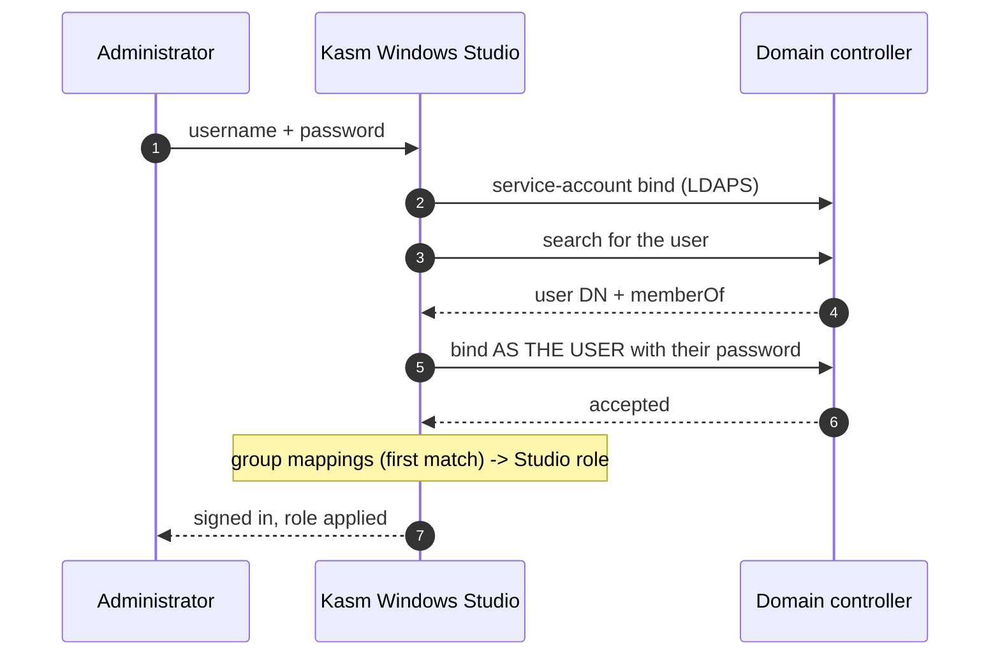

# Active Directory sign-in

People sign in with their AD credentials, and their AD group membership decides
what they can do in Studio. No separate account per administrator, and access follows
your existing joiners/movers/leavers process.



> [!IMPORTANT]
> This page describes `tp-2026.11.11` and later: the uploaded CA, account realms,
> Kasm-style group mappings and the real **Verify**. On `tp-2026.10.16` and earlier,
> enabling AD stops **local** accounts signing in, including the setup administrator. The
> setup wizard's AD step fails with *Unauthorized*, and only `LDAP_CA_CERT_FILE` is
> available for trust. Upgrade before enabling AD.

The second bind is the actual password check — Studio never compares password hashes
itself, and never stores the user's password.

---

## Requirements

| | |
| --- | --- |
| **LDAPS** | The URL must be `ldaps://host[:port]`. `ldap://`, paths and embedded credentials are **refused** when you save. |
| **A trusted certificate** | Studio verifies the DC's certificate. A private CA is fine. Upload it in Studio (below). |
| **A matching hostname** | The URL's host must be a name in the DC's certificate, so use the DC's DNS name and not its IP. The container must be able to resolve that name. |
| **A service account** | Read access to the user and group objects you care about. No write, no admin. |

---

## Configure

In **Settings → Active Directory** (or the first-run wizard's step 4):

| Field | Example | Notes |
| --- | --- | --- |
| Server URL | `ldaps://dc1.corp.example.com:636` | Must be `ldaps://`. If an invalid value is already stored, Studio blanks the box and says why. It might be a password a browser autofilled. |
| Bind DN | `svc-kasmstudio@corp.example.com` | UPN or full DN both work. |
| Bind password | | Encrypted at rest with your `APPLIANCE_MASTER_KEY`. |
| Base DN | `DC=corp,DC=example,DC=com` | Where user searches start. |

Users are looked up with `(sAMAccountName={username})`. `{username}` is escaped
before it's substituted. The filter can be changed only through the API
(`user_filter`), and a save from the screen resets it to the default.

### Trust the domain controller's certificate

Studio uses the first of these that applies and shows which one is in use:

1. **A CA certificate uploaded in Studio.** On the AD page, paste the PEM, upload a
   `.pem`/`.crt`, or click **Fetch from server**. Fetch lists the certificates the DC
   presents and their SHA-256 fingerprints. Compare the fingerprint with your CA
   before you tick the confirmation. On AD CS run `certutil -ca.cert ca.cer`; on Samba
   the CA is `/var/lib/samba/private/tls/ca.pem`. Many DCs, Samba included, don't send
   their CA, and Fetch says so when that happens. Paste the CA instead.
2. **`LDAP_CA_CERT_FILE`**, a path inside the container:

   ```bash
   # in .env, next to docker-compose.yml
   LDAP_CA_CERT_FILE=/etc/kasm-studio/ssl/corp-ca.pem
   ```
   ```yaml
   services:
     appliance:
       volumes:
         - ./corp-ca.pem:/etc/kasm-studio/ssl/corp-ca.pem:ro
   ```
   If it's set and the file is missing, sign-in fails with that reason.
3. **Public CAs only.** This works only if the DC's certificate comes from a public CA.
   Studio warns you about it.

Use **Verify LDAP Connection** before saving. It runs the same path as a real sign-in
on the values in the form, checking DNS, then TLS, then the service bind, then the base
DN. It names the step that failed. Give it a test username and password and it also signs
that user in and shows their groups, the matching rule and the resulting role.

---

## Local and directory accounts

As in Kasm, every Studio account has a realm: **local**, **ldap** or **saml**.

- **Local accounts always sign in with their own password, even while AD is enabled.**
  A broken or misconfigured directory can't lock out the administrator from first-run
  setup.
- A directory user's first sign-in creates an `ldap` account with no password.
- AD never signs in to, or takes over, a local account with the same username.
- An AD user deactivated in Studio can't sign in, even when AD accepts the password.

---

## Mapping groups to roles

These work like Kasm's **SSO Group Mappings**. Each rule maps an AD group, or with
**Assign all users** every directory user, to `admin`, `engineer`, `readonly` or a
custom role.

| AD group | Studio role |
| --- | --- |
| `CN=KasmStudio-Admins,OU=Groups,DC=corp,DC=example,DC=com` | `admin` |
| `CN=KasmStudio-Engineers,OU=Groups,DC=corp,DC=example,DC=com` | `engineer` |
| `CN=KasmStudio-Auditors,OU=Groups,DC=corp,DC=example,DC=com` | a custom role |

- **Rules are re-evaluated at every sign-in.** Remove someone from the group and they
  lose the role at their next sign-in. A session that is already open lasts until its
  token expires (8 hours).
- **First match wins**, because a Studio user has one role. Put the most privileged
  group first.
- **A user who matches no rule gets `readonly`.**
- **A full DN matches only that group.** Case and the spaces after commas don't matter.
  A bare name (`KasmStudio-Admins`) matches that CN in *any* OU, so use full DNs for
  privileged roles.
- **Only direct membership (`memberOf`) counts.** Nested groups are not expanded.
- **Only admins (`user:write`) can change the rules.** Whoever edits them can grant any
  role. A rule naming an unknown role or a deleted custom role is rejected.

---

## If the directory is unreachable

**By default, nobody signs in via AD.** That is deliberate: the alternative is falling
back to local passwords, which would let an account you disabled in AD keep working.
Local accounts are unaffected.

```bash
LDAP_STRICT_MODE=true    # default. Directory down = AD sign-in unavailable.
```

Setting it to `false` permits a local-password fallback, but **only** when the directory
is genuinely unreachable — a timeout, DNS failure, or TLS problem. A directory that
answers and *rejects* the password is always final, in either mode. A disabled AD
account can never be resurrected by a stale local password.

**Keep the local administrator account from first-run setup.** It is your way back in.
Store its password somewhere your team can reach without Studio.

---

## Troubleshooting

**Verify LDAP Connection** shows "Failed at: <step>":

| Verify reports | Cause and fix |
| --- | --- |
| Name resolution | The container can't resolve the DC's name. Fix DNS, or add an `extra_hosts` entry in compose. |
| Certificate not trusted | No CA uploaded, the wrong CA, or `LDAP_CA_CERT_FILE` not mounted. Upload the CA on the AD page. |
| Certificate name mismatch | The URL's host isn't in the certificate (often an IP was used). Verify lists the names the certificate does contain. |
| Network connection | Port 636 is closed, filtered, or rejected by a firewall between Studio and the DC. |
| Service account bind | The service account was refused. Verify gives AD's reason: wrong password, account disabled, locked, or password expired. |
| Base DN | The base DN doesn't exist or the service account can't read it. |

At sign-in:

| Symptom | Cause |
| --- | --- |
| `User 'x' not found in Directory` (audit log) | Base DN doesn't contain the user, or the filter attribute is wrong (`uid` vs `sAMAccountName`). |
| Sign-in works, but the role is always `readonly` | No rule matched. Use a test user in Verify to see the user's groups and which rule applies. Check the exact DN, and remember that nested groups don't count. |
| Everything fails right after a working setup | If `APPLIANCE_MASTER_KEY` changed, the stored bind password can no longer be decrypted (`Failed to decrypt stored LDAP bind password`). Re-enter it. |

Every attempt is recorded in the audit log with the specific reason. The sign-in page
deliberately shows the same message for a bad password and an unknown user, so it can't
be used to discover valid usernames — check the audit log for which actually happened.

---

## Testing without touching production AD

A throwaway domain controller is enough to validate the whole path:

```bash
docker run -d --name samba-ad -h dc1 --privileged \
  -e REALM=AD.EXAMPLE.COM -e DOMAIN=AD \
  -e ADMIN_PASS='Passw0rd!Lab123' -e DNS_FORWARDER=8.8.8.8 \
  -e BIND_NETWORK_INTERFACES=false \
  -p 3389:389 -p 3636:636 diegogslomp/samba-ad-dc:latest

docker exec samba-ad samba-tool group add KasmStudio-Admins
docker exec samba-ad samba-tool user create alice 'AlicePassw0rd!23'
docker exec samba-ad samba-tool group addmembers KasmStudio-Admins alice

# the CA to paste into Studio's AD page
docker exec samba-ad cat /usr/local/samba/private/tls/ca.pem > corp-ca.pem
```

Samba generates a certificate for `dc1.<realm>`, so point Studio at
`ldaps://dc1.ad.example.com:3636` and make that name resolve. Remove with
`docker rm -f samba-ad`.
